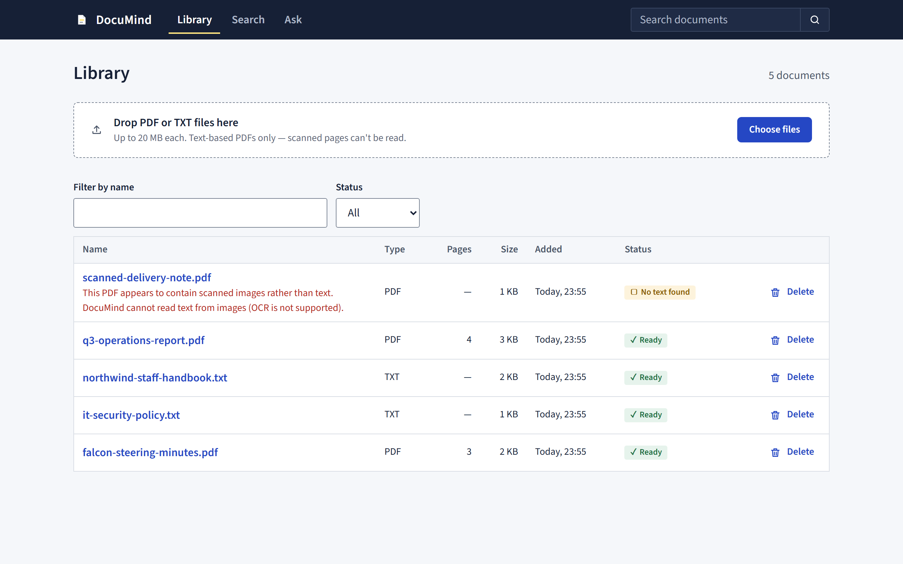
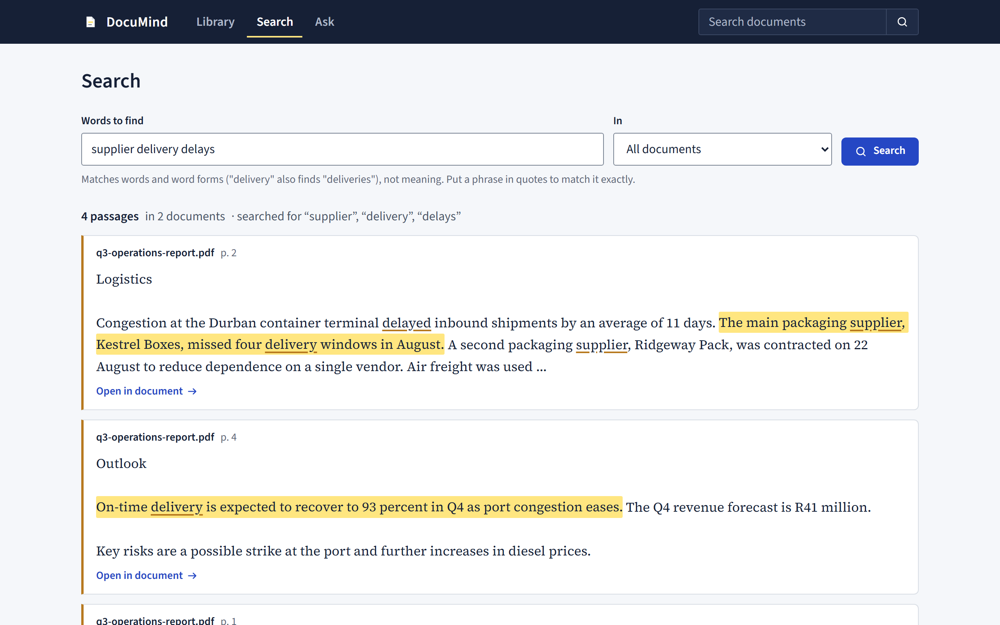
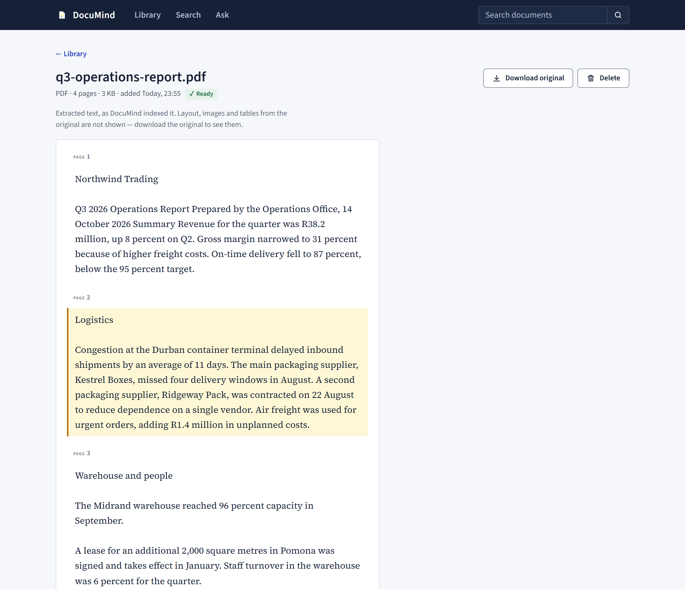
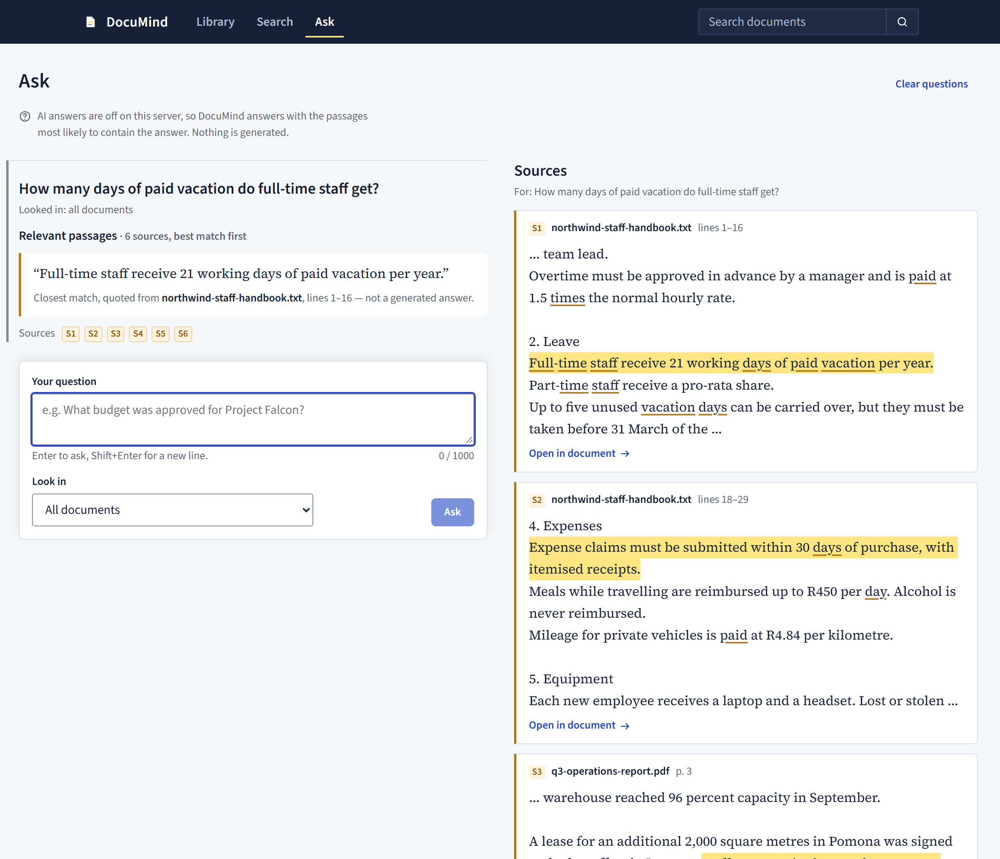
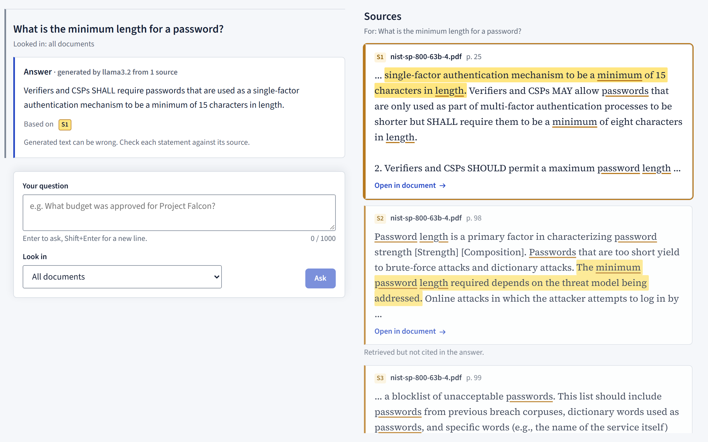

# DocuMind

A document knowledge assistant you run on your own machine. Upload PDFs and text files, search
their contents, and ask questions whose answers always point back to the exact passage — and page
— they came from.



## What it does

- **Builds a library from your files.** PDF and plain-text uploads show real progress, then are
  processed in a separate, time-limited process. Files with no text layer (scans) are marked
  *No text found* with the reason instead of being silently indexed as empty. Duplicates are
  recognised.
- **Searches it.** Keyword search (SQLite FTS5, BM25 ranking) with stemming, so "delays" also finds
  "delayed". Each result shows its document and page, highlights the sentence that best matches,
  and opens the document at the passage.
- **Answers questions with sources.** Questions and answers form a thread beside a panel showing
  the sources of the selected answer. Without an AI model, an answer is the closest sentence,
  quoted, with the most relevant passages numbered S1, S2… With an OpenAI-compatible model
  configured (hosted, or local such as Ollama), the model writes a short answer from those passages
  only and cites the ones it used; the server removes any citation it cannot match to a retrieved
  passage, and each citation opens its source with the supporting sentence highlighted. When the
  documents do not contain the answer, DocuMind says so.

| Search | Reader | Ask (no AI model) |
|---|---|---|
|  |  |  |

These screenshots use fictional documents with AI answers off (how they were made:
[docs/DEPLOYMENT.md](docs/DEPLOYMENT.md#6-screenshots)). The layout also works at phone width —
[mobile search](docs/screenshots/mobile-search.png).

**With a local AI model** — Llama 3.2 (3B) in Ollama on a laptop CPU, no account or key, asked about
NIST SP 800-63B-4, a real 129-page standard. The answer cites S1; the cited passage is shown beside
it:



## How it is built

```
Angular 21 SPA ──/api──▶ FastAPI ──▶ SQLite (documents, chunks, FTS5 index)
                           ├──▶ local file storage (uploads, outside any web root)
                           ├──▶ isolated worker process: PDF / text extraction
                           └──▶ optional OpenAI-compatible chat API
```

- **Backend:** Python, FastAPI, Pydantic, SQLAlchemy 2, SQLite with FTS5, pypdf. One process and
  no external services; the core features need no network access and no API key.
- **Frontend:** Angular 21 with standalone components, signals and zoneless change detection; no UI
  library. The interface design — serif type for source text, highlighter marks, page references
  everywhere — is described in [docs/DESIGN.md](docs/DESIGN.md).
- **Packaging:** one container image in which FastAPI also serves the built frontend.

The full design — trust model, processing pipeline, chunking, retrieval and its measured limits,
answer grounding, API — is in [docs/ARCHITECTURE.md](docs/ARCHITECTURE.md).

## Running it

### With Docker

```bash
docker build -t documind .
docker run -d --name documind -p 127.0.0.1:8000:8000 -v documind-data:/data documind
```

Open `http://localhost:8000`. Documents and the database stay in the `documind-data` volume. AI
answers, configuration and operations are covered in [docs/DEPLOYMENT.md](docs/DEPLOYMENT.md).

### Without Docker

Requires Python 3.12 or later and Node.js 22.12 or later.

```bash
cd backend
python -m venv .venv
.venv/bin/python -m pip install -c constraints.txt -e ".[dev]"   # Windows: .venv\Scripts\python
cd ../frontend
npm ci
npm run build
cd ../backend
DOCUMIND_STATIC_DIR=../frontend/dist/documind-web/browser .venv/bin/python -m uvicorn documind.main:create_app --factory --port 8000
```

On Windows PowerShell, set the variable with
`$env:DOCUMIND_STATIC_DIR='..\frontend\dist\documind-web\browser'` and use `.venv\Scripts\python`.
Open `http://localhost:8000`.

**For development**, run the backend without `DOCUMIND_STATIC_DIR` (API docs at
`http://localhost:8000/api/docs`) and the frontend with `npm start` in `frontend/`
(`http://localhost:4200`, API calls proxied to port 8000).

### AI answers (optional)

Set `DOCUMIND_LLM_MODEL`; for anything other than OpenAI also `DOCUMIND_LLM_BASE_URL`; and for
hosted providers `DOCUMIND_LLM_API_KEY` — in the environment or in a `.env` file in `backend/`
(git-ignored; see [.env.example](.env.example)). The key stays on the server; the browser learns
only the model name. Everything else works without it.

## Quality checks

| Suite | What it covers | Result (2026-10-26) |
|---|---|---|
| Backend — pytest | API, validation, extraction (generated valid, corrupt, encrypted, image-only and fake PDFs), PDF layout clean-up, chunking, search, answer grounding with fake providers, middleware, SPA serving | 304 passed on Windows; 3 more (memory limit) run only on Linux/macOS |
| Backend — ruff, mypy (strict) | Lint, formatting, types | clean |
| Frontend — Vitest | Services and components, driven through the DOM | 78 passed |
| End to end — Playwright | 8 complete workflows against the production build, and an axe accessibility audit of 6 page states | 14 passed, 0 accessibility violations |
| Retrieval evaluation | 30 questions over fictional documents | hit@5: 100% for keyword questions, 56% for paraphrases ([ARCHITECTURE.md §7](docs/ARCHITECTURE.md#evaluation)) |
| Real documents | Three public PDFs (a 129-page NIST standard, a 76-page HR guide, a two-column research paper), 11 natural questions judged by hand | processed in 1.7–6.4 s each; answer passage in the top 5 for 9 of 11 questions |
| Real AI model | Llama 3.2 (3B) on a laptop CPU, the same 11 questions plus an unanswerable one and a request to ignore the documents, each answer checked against its sources | 4 correct, 3 partly right, 2 wrongly declined, 1 unhelpful, 1 wrong with a real citation; both control questions declined; 26–42 s per answer ([ARCHITECTURE.md §9](docs/ARCHITECTURE.md#9-question-answering)) |
| Container | Build; non-root user; no data or `.env` file in the image; upload → search → Ask → delete in the running container | passed in CI ([run 40312172099](https://github.com/moeletsimelamu/documind/actions/runs/40312172099)); not run locally |

```bash
cd backend
.venv/bin/python -m pytest && .venv/bin/ruff check . && .venv/bin/mypy
```

```bash
cd frontend
npm test && npm run format:check
npx playwright install chromium
npm run e2e
```

GitHub Actions ([.github/workflows/ci.yml](.github/workflows/ci.yml)) runs all of it on every push
and pull request, with the backend on Python 3.12 and 3.14. No step calls an AI provider.

## Security

DocuMind is a **single-user tool with no accounts**: anyone who can reach it can read and delete
every document. It answers only to local host names, refuses cross-site write requests, and the
container is published on loopback. Uploaded files are treated as hostile (type checked by
content, size and page limits, parsed in an isolated process with a timeout), and document text is
treated as untrusted input to the language model. The self-review, with each finding and how it
was verified, is in [docs/REVIEW.md](docs/REVIEW.md); it is not an independent audit.

## Known limitations

- **Keyword search, not semantic search.** Questions phrased in different words from the document
  are often missed (measured above). Embedding-based retrieval is the natural next step.
- **No OCR.** Scanned PDFs are detected and reported, not read.
- **Single user, no authentication.** Not suitable for exposing to a network as it is
  ([what that would need](docs/DEPLOYMENT.md#5-putting-it-on-a-network-not-done-requirements-if-you-do)).
- **Generated answers are only as good as the model.** With the small local model tested, about a
  third of answers were fully right, and one was wrong while citing a real passage — which is why
  every answer shows its sources. Hosted and larger models have not been tested.
- **No public deployment.** The container image is built and tested in CI.
- Browser-tested in Chromium only; not tested with screen readers.

## Documentation

| Document | Contents |
|---|---|
| [ARCHITECTURE.md](docs/ARCHITECTURE.md) | Technical design and the reasons for it |
| [DESIGN.md](docs/DESIGN.md) | Interface and visual design |
| [REVIEW.md](docs/REVIEW.md) | Security and accessibility review |
| [DEPLOYMENT.md](docs/DEPLOYMENT.md) | Running, configuring and operating it |
| [DEMO.md](docs/DEMO.md) | A five-minute demonstration script |
| [PLAN.md](docs/PLAN.md) | Phases, completion criteria and decision log; reports in [phase-reports/](docs/phase-reports) |
